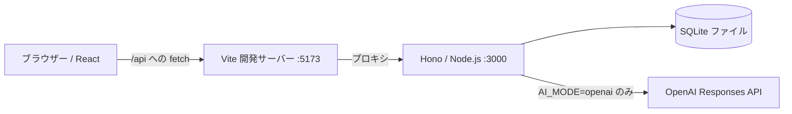

# 設計とAPI

## データの流れ



`npm run dev` が2つの開発サーバーを起動します。Viteが `/api` をHonoに転送するので、ブラウザー側にAPIサーバーのURLやAPIキーは不要です。ビルド済みの画面はHonoからも配信できます。

## 役割を読む順番

1. `frontend/app/src/App.tsx`：一覧を取得し、Reactのstateで検索・絞り込み・表示切り替え。
2. `frontend/app/src/CardDialog.tsx`：フォーム、AI提案、保存・削除。
3. `frontend/app/src/api.ts`：HTTPの送受信と利用者向けエラー。
4. `api/app/src/app.ts`：ルート、入力チェック、AI利用制限。
5. `api/app/src/database.ts`：SQLite操作。SQLにはプレースホルダーを使う。
6. `api/app/src/ai.ts`：モックと実API、プロンプトの改造箇所。
7. `shared/board.ts`：両方で使う型、カテゴリとステータス。

TypeScriptはデータの形を説明しますが、ブラウザー以外からもAPIを呼べるため、API側の実行時チェックも必要です。バックエンドはNode.js 24のTypeScript型除去機能で実行するので、enum等の変換が必要な文法を避け、型のimportに `import type` を使います。

## API契約

開発中のAPI直アクセス：`http://127.0.0.1:3000`。画面からは同じパスを `/api` で呼びます。レスポンスは原則JSON、エラーは `{ "error": "利用者向けメッセージ" }` です。

| メソッド | パス | 結果 |
| --- | --- | --- |
| GET | `/healthz` | 200 `{ "status": "ok" }` |
| GET | `/api/config` | 200 `aiMode`, `aiAvailable`, `dailyLimit`。キーは含めない |
| GET | `/api/cards` | 200 `{ "cards": [...] }`、更新日時の降順 |
| GET | `/api/cards/:id` | 200 `{ "card": {...} }` |
| POST | `/api/cards` | 201 `{ "card": {...} }` |
| PUT | `/api/cards/:id` | 200 `{ "card": {...} }`、全編集項目を送信 |
| DELETE | `/api/cards/:id` | 204、本文なし |
| POST | `/api/cards/:id/analyze` | 200 `{ "card": {...} }`、分析結果を自動保存 |

一覧は `q`（タイトル・説明の部分一致）、`category`、`status` を組み合わせて受け付けます。UIは取得済みカードを同じ条件で絞り込みます。

```json
{
  "title": "読書記録",
  "description": "心に残った一節を集めたい",
  "category": "学び",
  "status": "アイデア"
}
```

- `title`：必須。前後空白を除いて1〜120文字。
- `description`：文字列、4,000文字以内。空文字可。
- `category`：アプリ / 暮らし / 学び / 仕事 / その他。
- `status`：アイデア / 進行中 / 完了。
- 不正なJSON・入力：400。未存在：404。大きすぎるリクエスト：413。
- AI分析の競合：409。日次回数制限：429。AI障害：502。AI未設定：503。
- 登録時にUUID、`createdAt`、`updatedAt` を付与。日付はISO 8601のUTC文字列。

カードには `analysis`、`analyzedAt`、`analysisMode` が付き、未分析では `null`。最新1件のみ保持します。タイトル・説明変更時は分析をクリアし、カテゴリ・ステータスだけの変更では保持します。AI待機中に別画面から本文変更・削除された場合は結果を保存せず409を返します。

## データベース

`.local/idea-board.sqlite` を初回起動で自動作成します。データはNode.js内蔵の `node:sqlite` で読み書きし、別のDBサービスは不要です。WALモードと5秒の待機時間を設定しています。

- `cards`：カード本体と最新の分析結果。
- `ai_usage`：UTC日付と実API試行回数。予約を単一SQLで行い、同時リクエストでも上限を維持。
- サンプルデータは `cards` テーブルを初めて作るときだけ投入。削除したカードは再起動しても復活しない。
- DBパスはリポジトリルート基準。`DATABASE_PATH` で変更可。
- スキーマの本格的なマイグレーションは教材の基本構成に含めない。項目追加では第3回の手順で既存DBの移行を追加する。

## 環境変数

| 名前 | 既定値 | 説明 |
| --- | --- | --- |
| `AI_MODE` | `mock` | `mock` / `openai` / `disabled` |
| `OPENAI_API_KEY` | なし | APIのみ読む。未設定でもCRUDは起動 |
| `OPENAI_MODEL` | `gpt-4.1-mini` | 講師が利用可能性を確認して指定 |
| `AI_DAILY_LIMIT` | `20` | 実API試行回数、整数1〜1000 |
| `AI_MAX_OUTPUT_TOKENS` | `800` | 出力上限、整数1〜2000 |
| `DATABASE_PATH` | `.local/idea-board.sqlite` | SQLiteの保存先 |
| `PORT` | `3000` | APIのポート。変更時は下記も参照 |
| `HOST` | `127.0.0.1` | ComposeのAPIでは `0.0.0.0` |
| `API_PROXY_TARGET` | `http://127.0.0.1:3000` | Vite用。Composeでは `http://api:3000` |

`.env` はAPIがルートから読み込みます。既にOS環境に設定された値が優先します。Viteは `.env` を読み込まず、`VITE_` の付いたAPIキーも作成しません。APIはローカル教材用で、ブラウザーからの書き込みOriginをローカルの画面に限定します。

## テスト

`npm test` でNode.js標準のテストランナーを実行。APIを実際のHTTPに載せずHonoの `app.request()` で呼び、一時DBでCRUD・永続化・競合・制限を確認します。Responses APIはSDKに偽のfetchを渡し、リクエスト形式と応答読み取りを外部通信なしで確認します。
